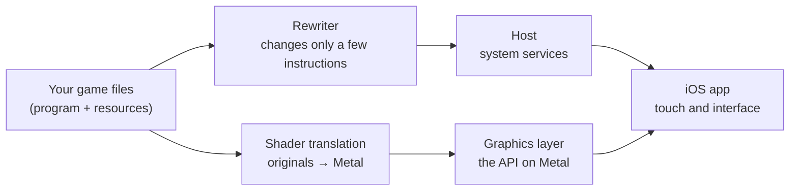

# Super Mario Odyssey Mobile

**An open-source iOS compatibility layer that runs the Nintendo Switch copy of Super Mario Odyssey you
bought, on your own iPhone.** The game's own aarch64 program executes directly on the device — no CPU
emulation; only the handful of instructions that cannot run unchanged under Apple's kernel are
rewritten, and the platform services it calls are provided by a host written for Apple platforms.
**Bring your own game files** — this repository contains no game content.

The technical path is taken wholesale from [jhaizhou-ops/d2r-mobile](https://github.com/jhaizhou-ops/d2r-mobile)
(MIT). License: MIT · Primary language: Chinese ([README.md](README.md)) · English: this file.

> ## ⚠️ Status: early infrastructure — **not playable yet**
>
> This is work in progress, not a playable build. What is done and verified is "understand the game and
> rewrite its program into a form Apple's kernel can execute"; the **host (system-service HLE), the
> graphics layer (NVN→Metal) and touch input have not been started.**
>
> Progress, evidence and reproduction commands: **[STATUS.md](STATUS.md)**. Do not expect a game to
> start yet — installing the current build shows a status page.

## What it is, and what it is not

**It is:**

- **The game's own aarch64 program executing directly on the device**, with no emulated CPU. iPhone and
  Switch use the same class of processor; only the few instructions that cannot run unchanged under
  Apple's kernel are rewritten (`x18` and `tpidr_el0` accesses, `svc` system calls, `cntpct_el0`
  timers), and every other byte of the program is left exactly as shipped.
- The platform services it expects — system calls, file system, graphics API, audio, input — provided
  by a **host** written for Apple platforms. The graphics API is reimplemented entirely on Metal with
  no emulation layer in between; shaders are translated offline.

**It is not:**

- **An emulator**, cloud gaming, or streaming.
- **A source of game content. It contains none and distributes none** — no program, art, audio, text,
  data table or shader. All of that is generated on your own machine from your own files
  (see [docs/GAME_FILES.md](docs/GAME_FILES.md)). What the repository does carry is *records of facts
  about the game* needed to make the port work, listed item by item in [docs/DERIVED.md](docs/DERIVED.md).
- **Online.** No multiplayer; the game runs fully offline.

## Progress

**Milestones** (towards running on a real device): **M0 guest side ready ✅** → **M1 installs, boots, logs on screen and can export them ✅** (host wired into the app, resources packed into two volumes) → M2 first frame → M3 title screen → M4 playable. Deliverables, verification method and size estimates per milestone are in the "project plan v2" section of [STATUS.md](STATUS.md).

| Stage | State | Evidence |
|---|---|---|
| Unpacking game files (NSP → ExeFS / RomFS, 4,636 files / 5.2 GB) | ✅ done, verified | `smo/tools/nsp_extract.py` (algorithm checked line by line against hactool's source) |
| Reconnaissance (build IDs / 700 imports / the single graphics entry / 469 NVN names) | ✅ done | `nso_info.py`, `import_graph.py`, `xref.py` |
| Program rewrite (all 4 NSOs) | ✅ structural check + **dynamic equivalence** | `patch_nso.py`, `rewrite_check.py`; Unicorn equivalence: **svc 106/106, cntpct 29/29, rtld 4/4** |
| Shaders (28 archives → 18,487 → 18,470 unique → SPIR-V → MSL) | ✅ 0 failures | `sharcb.py` + `dmsh_xlate` + `glsl_facts.py` |
| Shader bridge (runtime control section → translated shader) | ✅ 400/400 real blobs matched | `shader_index.py`, `nvn_shader.c` |
| Host loader (multi-module mapping / cross-module relocations / import resolution) | ✅ runs on real artifacts + two independent cross-checks | `loader_core.c` (JUMP_SLOT 639 == 639 PLT stubs; host imports 12/4 == `import_graph` 12/4) |
| Kernel SVCs (memory family / thread family) | ✅ 20 + 15 assertions | `hle_svc.c`, `hle_thread.c` |
| System-service HLE (fs 26 functions / oe / hid) | ✅ 30 + 24 assertions; plus a 447-entry takeover list and named stubs for the rest | `hle_fs.c`, `hle_oe.c`, `hle_hid.c`, `hle_force_gen.c` |
| NVN interface layer (469 names) | ✅ unit-tested, mechanism fully mapped | `hle_nvn.c`, `nvn_table.c` (the `nvnLoadCProcs` → 461 names mechanism) |
| NVN core state layer (38 implementations) | ✅ 38 assertions | `nvn_core.c`, `nvn_state.c` |
| Replay bookkeeping + pipeline keys (no Metal) | ✅ 16 assertions | `nvn_replay.c` |
| Texture block-linear layout (sizing + detiling, no Metal) | ✅ 36 assertions + **123/123 real textures match** | `nvn_tex.c` (sizing ported from deko3d); `tex_layout_check.py` checks each against the game's own BNTX records |
| Verification layer (regression entry + design-premise check) | ✅ 12 pass · 2 skip | `smo/verify/regress.sh`; NVN opacity: **0 counterexamples** over 1012/1706 call sites |
| **Metal replay (the half that actually calls Metal)** | ❌ not started (needs macOS / a device) | |
| iOS three-segment embedding | 🚧 generator + verifier done (locally verifiable); loader branch and link flags pending | `gen_embed.py`, `check_embed.py` |
| iOS app shell + unsigned IPA (CI) | 🚧 needs re-verification | 2 C unit tests failed to link in the ubuntu job since 10-14; fixed (STATUS 2.80), pending a push to confirm |
| Touch / controller input | 🚧 state layer and layouts verified (hid / oe), front end not wired | `hle_hid.c`, `hle_oe.c` |

**Can it be played yet? No.** What is missing is the Metal half of the graphics layer and the iOS
embedded-image loading branch — both need macOS / a real device. Round-by-round measurements live in
[STATUS.md](STATUS.md).

## Facts measured from the game

| Item | Measured |
|---|---|
| Title / version | `0100000000010000`, US, v0 |
| Program NCA | 1.24 GB logical content (5.54 GB container, 5.5 GB of it RomFS) |
| ExeFS modules | `main` 15,388,240 B · `sdk` 4,179,745 B · `subsdk0` 3,175,954 B · `rtld` 7,099 B |
| RomFS | 4,636 files / 5.50 GB |
| Imports of `main` | 700, of which **exactly one is the graphics entry: `nvnBootstrapLoader`** |
| NVN names the game asks for | 469 distinct `nvn*` |
| Engine | `agl` (Nintendo's graphics library) + `sead` |
| Shaders | 27 `*.szs` under `RomFS/ShaderData/` (Yaz0 + SARC) containing `*.sharc` (agl ShaderArchive) |
| `glslc` (runtime GLSL compiler) | all 8 imports are **dead references**, zero call sites ⇒ shaders ship precompiled |

## How it works

## Building

The current pipeline uses pinned nxnative sources and base + update **1.4.1**.
Run the `build nxnative ipa` GitHub Actions workflow. Its default `shell` mode
produces a public IPA with no game content. Manual `personal` builds fetch
user-owned NSPs from a private release and keys from `SMO_PROD_KEYS`, then publish
the personal IPA and separate resource parts only to the private build repository.
Restore the parts with `scripts/restore_nxnative_resources.py`, then copy `romfs/`,
`msl/` and `resource_manifest.json` into the app's Documents. The personal IPA
contains the rewritten game program; the public shell only checks resources.
See [installation and build instructions](docs/README_INSTALL.md).

The following routes describe the older runtime and are retained as historical notes.

### Route A: build on GitHub (recommended, no Mac needed)

[`.github/workflows/build-shell-ipa.yml`](.github/workflows/build-shell-ipa.yml) builds the app shell on
a GitHub macOS runner (which ships Xcode) and produces an **unsigned IPA** as an artifact and, for tags,
as a release asset. Push the repository, run the `build shell ipa` workflow, download
`SMOMobile-shell.ipa`, then sign it yourself with your own Apple ID (Sideloadly / AltStore) and install.

A free Apple ID is enough: signatures expire after 7 days (re-sign and reinstall; saves stay), at most 3
devices and 3 apps per device.

### Route B: local iOS build

Needs an Apple Silicon Mac with Xcode (`xcodebuild`). The cloud route above is this route, automated.

### Game files

Dump them from your own Switch (see [docs/GAME_FILES.md](docs/GAME_FILES.md)): the ExeFS
(`main` / `sdk` / `subsdk0` / `rtld` / `main.npdm`) and the RomFS from the same Program NCA.

## Acknowledgements

This project stands on the open-source work below. Thank you to its authors and maintainers.

- **[jhaizhou-ops/d2r-mobile](https://github.com/jhaizhou-ops/d2r-mobile)** (MIT): the **reference project**. The technical path ("Horizon compatibility layer + native aarch64 execution") and the skeleton of the loader / host layer / rewriter / embed packer are derived from it (`smo/tools/port_rewriter.py`, `smo/host/loader_core.c`, `smo/host/entry.S`, `smo/ios/tools/gen_embed.py` — each file header states the derivation).
- **Ryujinx** (Ryubing, MIT): `smo/third_party/ryujinx/` bundles its shader translator (Maxwell → SPIR-V) unchanged. It is the authoritative Maxwell decoder, so we use it as the criterion for verifying the structure of SMO's shader blobs (STATUS.md round 7).
- **nvn.h** (h1k421, MIT): NVN type declarations (`smo/gfx/nvn/include/nvn.h`). We use **only its enum values** (660 of them, extracted by `smo/gfx/nvn_enum.py`), never its struct layouts — see `smo/gfx/nvn/include/README.md` for why.
- **SPIRV-Cross** (Khronos, Apache-2.0): offline SPIR-V → Metal Shading Language translation.
- **hactool** (SciresM, MIT): the source of the NSP/PFS0 unpacking algorithms — `smo/tools/nsp_extract.py` was written line by line against it (recorded in `docs/DERIVED.md`).
- **LLVM** (Apache-2.0 with LLVM exceptions): disassembly. `smo/tools/rawdis.py` wraps a flat image into a minimal ELF and hands it to `llvm-objdump`; that is what made round 14 (the real NVN mechanism) possible.
- **Capstone** (BSD-3): instruction decoding (jump-table recognition in the rewriter; `smo/tools/check_x18.py` uses its register read/write sets to tell `x18` from `s18/d18`).
- **XcodeGen** (MIT), **.NET** (MIT): generating the Xcode project and running `dmsh_xlate`.
- Python side: numpy, Pillow, zlib and friends (see `requirements.txt`).

**Provenance of the rewrite rules (for transparency)**: the batch of rewrites in `port_rewriter.py` that lets the game run offline comes, per the reference project, from a community patch called **LFS Mod Offline Fix**, whose original publication they have no reliable record of. We keep the same statement: **the original provenance of that batch is likewise untraceable**; we merely carry it forward with this note.

**Planned but not yet bundled** (recorded in STATUS.md): **deko3d** (devkitPro, zlib) for the texture layout size algorithm (the reference project's `nvn_tex.c` is ported from it), **bcdec** (iOrange, MIT/Unlicense) to decode BC textures into non-BC formats on iOS (Apple GPUs do not support BC), and the use of **Unicorn** for "equivalence checks of the rewrites" that the reference project mentions — the last one is valuable for our "every conclusion must have reproducible evidence" rule and we intend to adopt it.

## License

MIT, see [LICENSE](LICENSE). The license covers this repository's source code only, not any game content.

Not affiliated with or endorsed by Nintendo. Super Mario Odyssey is a trademark of Nintendo.
