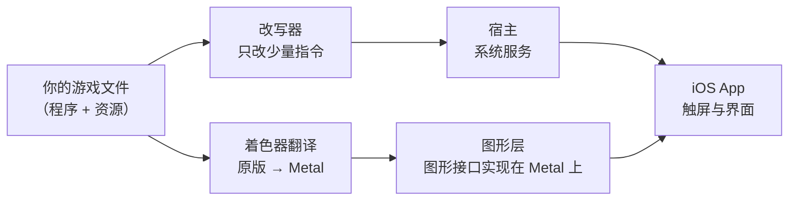

# Super Mario Odyssey Mobile

**把你在 Switch 上买的《超级马里奥 奥德赛》搬到 iPhone 上的开源兼容层。** 游戏自己的 aarch64 程序
直接在手机上执行，不模拟 CPU；只把「在苹果内核上不能原样执行的少量指令」改写掉，再自己实现它依赖的
Switch 系统服务与图形接口。**自带游戏文件（bring your own game files）** —— 本仓库不含任何游戏内容。

新的 IPA 构建使用固定版本的 [seedds/nxnative](https://github.com/seedds/nxnative)（MIT），
支持本体叠加 1.4.1 升级档；RomFS 和编译后着色器由用户复制到应用 Documents。
旧版兼容层源自 [jhaizhou-ops/d2r-mobile](https://github.com/jhaizhou-ops/d2r-mobile)（MIT），保留作历史开发记录。
协议：MIT · 主语言：中文 · English: [README.en.md](README.en.md)

> ## ⚠️ 现在的状态：启动页已验证，完整游戏仍在验证
>
> 真机与 ARM64 启动检查已到达游戏的手柄说明/Start 页面；iOS 里已有双摇杆与 16 键触屏手柄，并接入游戏 HID 输入。
> 当前重点是确认真机按键、持续音频和长时间运行温度。完整关卡游玩与长时间稳定性还没有验证通过。
>
> 真机手柄和性能说明见 [DEVICE_CONTROLS.md](docs/DEVICE_CONTROLS.md)，参考项目的取舍见 [REFERENCE_NXNATIVE.md](docs/REFERENCE_NXNATIVE.md)。
> 想看每一步做到哪、依据是什么：**[STATUS.md](STATUS.md)**（带实测输出与复现命令）。

---

## 它是什么，不是什么

**是：**

- 游戏**自己的 aarch64 程序在设备上直接执行**，没有模拟 CPU。iPhone 与 Switch 是同一类处理器；
  只有少数在苹果内核下不能原样跑的指令被改写（`x18` 与 `tpidr_el0` 的读写、`svc` 系统调用、
  `cntpct_el0` 计时器），程序其余每一个字节保持原样。
- 它依赖的平台服务 —— 系统调用、文件系统、图形接口、音频、输入 —— 由一套为苹果平台写的
  **宿主**提供。图形接口整个重实现在 Apple 的 Metal 上，中间没有模拟层；着色器离线翻译。
- 一个把这件事做到底的项目：目标是完整的触屏方案、iPhone 全面屏显示、手柄支持、中英文。

**不是：**

- **不是模拟器**，不是云游戏，不是串流。
- **不是游戏内容的来源。本仓库不含、也不分发任何游戏内容**：没有游戏程序、美术、音频、文本、
  数据表或着色器本体。这些都在你自己的机器上、用你自己的游戏文件生成（见 [docs/GAME_FILES.md](docs/GAME_FILES.md)）。
  仓库里带的是「为了让移植成立而记录的**关于游戏的事实**」—— 改写规则、模块结构、导入清单、
  着色器标识等，逐项列在 [docs/DERIVED.md](docs/DERIVED.md)。
- **不是能联机的**：没有多人，游戏全程离线，不需要在线账号。

## 现在的进度

**里程碑**（到「实机跑起来」）：**M0 客体侧就绪 ✅** → **M1 能装能启 + 日志上屏/导出 ✅**（宿主已接入 App，资源打成两卷）→ M2 第一帧（离屏部分已在 CI 验：清屏/着色器管线/纹理往返/管线缓存）→ M3 标题画面 → M4 能玩。逐项交付物、验证方式与规模估计见 [STATUS.md](STATUS.md) 的「项目计划 v2」。

| 阶段 | 状态 | 依据 |
|---|---|---|
| 游戏文件解包（NSP → ExeFS / RomFS，4636 个文件 / 5.2 GB） | ✅ 完成并验证 | `smo/tools/nsp_extract.py`（算法逐条对照 hactool 源码） |
| 模块侦察（构建号 / 700 个 import / 唯一图形入口 / 469 个 NVN 名字） | ✅ 完成 | `nso_info.py`、`import_graph.py`、`xref.py` |
| 程序改写（4 个 NSO） | ✅ 结构自检 + **动态等价** | `patch_nso.py`、`rewrite_check.py`；Unicorn 等价：**svc 106/106、cntpct 29/29、rtld 4/4** |
| 着色器解包与翻译（28 个归档 → 18487 → 18470 去重 → SPIR-V → MSL） | ✅ 0 失败 | `sharcb.py` + `dmsh_xlate` + `glsl_facts.py` |
| 着色器桥（运行时控制段 → 已译着色器） | ✅ 真实数据 400/400 命中 | `shader_index.py`、`nvn_shader.c` |
| 宿主装载器（多模块映射 / 跨模块重定位 / import 解析） | ✅ 真实产物跑通 + 两处交叉验证 | `loader_core.c`（JUMP_SLOT 639 == PLT 桩 639；宿主 import 12/4 == `import_graph` 12/4） |
| 内核 svc（内存族 / 线程族） | ✅ 20 + 15 条断言 | `hle_svc.c`、`hle_thread.c` |
| 系统服务 HLE（fs 26 个 / oe / hid） | ✅ 30 + 24 条断言；另有 447 条接管清单 + 未实现记名桩 | `hle_fs.c`、`hle_oe.c`、`hle_hid.c`、`hle_force_gen.c` |
| NVN 接口层（469 个名字） | ✅ 单测 + 机制挖清 | `hle_nvn.c`、`nvn_table.c`（`nvnLoadCProcs` → 461 个名字的机制） |
| NVN 核心状态层（38 个实现） | ✅ 38 条断言 | `nvn_core.c`、`nvn_state.c` |
| 重放记账 + 管线键（不含 Metal） | ✅ 16 条断言 | `nvn_replay.c` |
| 纹理块线性布局（尺寸 + 解交错，不含 Metal） | ✅ 36 条断言 + **真实贴图 123/123 对上** | `nvn_tex.c`（尺寸算法移植自 deko3d）；`tex_layout_check.py` 对游戏自己的 BNTX 记录逐张核对 |
| 验证层（回归总入口 + 设计前提核验） | ✅ 通过 12 · 跳过 2 | `smo/verify/regress.sh`；NVN 不透明性 1012/1706 调用点 **0 反例** |
| Metal 渲染 | ✅ Joy-Con 手柄说明页已由真实 ARM64 客体提交 GPU 并完成多帧呈现 | 完整关卡与真机持续表现仍需验证 |
| iOS 三段内嵌出包 | ✅ 装载器、嵌入载荷与签名包检查已接入 CI | `gen_embed.py`、`check_embed.py` |
| iOS App 壳 + 私有诊断 IPA（CI） | ✅ 已有私有构建路径；音频修复版正在重新验证 | `.github/workflows/build-shell-ipa.yml` |
| 触屏手柄 | ✅ 双摇杆、16 键、多点触摸与 HID 输入已接入 | 首次真机按键测试见 [DEVICE_CONTROLS.md](docs/DEVICE_CONTROLS.md) |
| 音频与温控 | 🚧 RemoteIO、混音节流和温控降帧已接入；持续出声/长时间温度仍需真机验证 | [DEVICE_CONTROLS.md](docs/DEVICE_CONTROLS.md) |

**能不能完整游玩：还未确认** —— 已到达真实游戏启动页，但完整关卡运行、持续声音和长时间设备稳定性仍需验证。
细节与每一轮的实测记录在 [STATUS.md](STATUS.md)。

## 关于这个游戏，实测出来的事实

这些都是从你自己的游戏文件里量出来的，不是从别处抄的（详细输出见 [STATUS.md](STATUS.md)）：

| 项目 | 实测 |
|---|---|
| 标题 / 版本 | `0100000000010000`，US，v0（初版） |
| Program NCA | 1.24 GB 逻辑内容（容器里 5.54 GB，含 5.5 GB RomFS） |
| ExeFS 模块 | `main` 15,388,240 B · `sdk` 4,179,745 B · `subsdk0` 3,175,954 B · `rtld` 7,099 B |
| RomFS | 4636 个文件 / 5.50 GB |
| `main` 的导入 | 700 条，其中**图形接口只有一条：`nvnBootstrapLoader`** |
| 游戏向该接口索取的名字 | 469 个不同的 `nvn*` |
| 引擎 | `agl`（Nintendo 图形库）+ `sead`（框架） |
| 着色器 | `RomFS/ShaderData/` 27 个 `*.szs`（Yaz0 + SARC），内含 `*.sharc`（agl ShaderArchive） |
| `glslc`（GLSL 运行时编译器） | 8 个导入全是**死引用**，零调用点 ⇒ 着色器是预编译的 Maxwell 二进制 |

**为什么是这条路**：iPhone 与 Switch 是同一类处理器，所以游戏程序不必模拟就能执行；而它与
Switch 操作系统的全部接触面是收敛的 —— 内核系统调用、一组系统服务、以及一个图形接口入口。
把这三样在苹果平台上重新实现，游戏就能以原样的逻辑跑起来。

## 它是怎么工作的



| 部件 | 位置 | 做什么 |
|---|---|---|
| 程序改写器 | [`smo/tools/patch_nso.py`](smo/tools/patch_nso.py) | 只改写不能在苹果内核上原样执行的少量指令，程序其余部分逐字节保持原样 |
| 宿主 | `smo/host/`（待建） | 加载改写后的程序，提供它调用的平台服务 |
| 图形 | `smo/gfx/`（待建） | 在 Metal 上实现游戏的图形接口；着色器离线翻译 |
| iOS App | [`smo/ios/`](smo/ios/) | App 壳、触屏与界面 |
| 验证 | [`smo/tools/rewrite_check.py`](smo/tools/rewrite_check.py) 等 | 改写产物结构自检、等价性检查 |

## 构建

统一入口为 `python scripts/build_nxnative_ipa.py --mode shell|personal`。
GitHub Actions 的 `build nxnative ipa` 在**当前公共仓库**使用 macOS/Xcode 构建，Windows 用户无需本地 Mac。
私有仓库仅存储输入、个人产物和日志，不运行 Actions。

- 提交、PR 和默认手动构建只生成 **SMOMobile-shell.ipa**，完全不含游戏内容。
- 手动选择 `personal`，使用私有输入中的本体 NSP、1.4.1 升级 NSP 和 Actions Secret `SMO_PROD_KEYS`。
- **SMOMobile-1.4.1.ipa** 包含用户自己的游戏程序及加载表，仅上传私有存储仓库；RomFS 和游戏着色器单独输出。

安装个人 IPA 后，将资源包还原得到的 `romfs/`、`msl/` 和 `resource_manifest.json`
复制进「文件 → 我的 iPhone → SMO Mobile」。纯壳只能检查资源；运行游戏需要个人 IPA。
构建配置、资源分片还原和本地命令见 [安装说明](docs/README_INSTALL.md)。
新的 nxnative 路径与下面记录的旧版运行时进度分开验收，真机结果以对应构建报告和日志为准。

## 支持哪些设备

| 设备 | 能不能跑 |
|---|---|
| iPhone 17 Pro Max（A19，本项目的主要目标） | 目标设备 |
| iPhone 15 Pro 及以后的 A17 Pro 机型 | 预期可跑（与参考项目的验证档同级） |
| A16 及更早（iPhone 14 系列、iPhone 15/15 Plus） | 参考项目在这一档需要额外的 ASTC 贴图包；本项目尚未处理 |
| iPad | 本移植只针对 iPhone |

## 目录

```
smo/tools/       解包与改写工具（Python）
smo/ios/         iOS App 壳与出包脚本
work/            解包与改写产物（不进仓：全是游戏内容）
STATUS.md        做到哪一步、依据是什么、下一步
docs/            游戏文件准备、衍生内容说明
```

## 关于仓库里有什么、没有什么

**没有**：游戏程序、美术、音频、文本、数据表、着色器本体、存档。
**有**：改写规则、模块结构与导入清单、着色器标识、以及为让移植成立必须记录的其它事实。
逐项说明见 [docs/DERIVED.md](docs/DERIVED.md)。

## 致谢

本项目站在下面这些开放工作上。谢谢这些作者与维护者。

- **[jhaizhou-ops/d2r-mobile](https://github.com/jhaizhou-ops/d2r-mobile)**（MIT）：**参考项目**。技术路径、「Horizon 兼容层 + 原生 aarch64 执行」这条路线、以及装载器/宿主层/改写器/内嵌出包的骨架都从它派生（`smo/tools/port_rewriter.py`、`smo/host/loader_core.c`、`smo/host/entry.S`、`smo/ios/tools/gen_embed.py` 等文件头都写明了派生关系）。
- **Ryujinx**（Ryubing，MIT）：`smo/third_party/ryujinx/` 原样收录其着色器翻译器（Maxwell → SPIR-V）。它是权威的 Maxwell 解码实现，我们把它当作 SMO 着色器块结构的判据（见 STATUS.md 第七轮）。
- **nvn.h**（h1k421，MIT）：NVN 类型声明（`smo/gfx/nvn/include/nvn.h`）。我们**只用其中的枚举值**（`smo/gfx/nvn_enum.py` 抽出 660 条），不用它的结构体布局 —— 理由见 `smo/gfx/nvn/include/README.md`。
- **SPIRV-Cross**（Khronos，Apache-2.0）：SPIR-V → Metal Shading Language 的离线翻译。
- **hactool**（SciresM，MIT）：NSP/PFS0 解包的算法来源 —— `smo/tools/nsp_extract.py` 是逐行对照其实现写的（`docs/DERIVED.md` 有这条记录）。
- **LLVM**（Apache-2.0 with LLVM exceptions）：反汇编。`smo/tools/rawdis.py` 把摊平映像包成最小 ELF 后交给 `llvm-objdump`，第十四轮能挖清 NVN 的真实机制靠的就是它。
- **Capstone**（BSD-3）：指令解码（改写器的跳转表识别；`smo/tools/check_x18.py` 用它的读写集合区分 `x18` 与 `s18/d18`）。
- **deko3d**（devkitPro，zlib）：纹理块线性布局的**尺寸算法**来源。我们没有收录它的源码，只把 `source/dk_image.cpp` 的那几个函数按 C 重写进 `smo/gfx/nvn/nvn_tex.c`（函数一一对位，文件头与 `smo/third_party/README.md` 标明出处与「这是移植」）。实测：按它算出的大小与游戏自己的 BNTX 记录逐张一致。
- **BNTX-Extractor**（aboood40091）：GOB 内部 512 字节的重排公式（`swizzle.py` 的 `getAddrBlockLinear`）。deko3d 没有这个公式 —— 它把解交错交给 GPU，而我们要在 CPU 侧解。
- **XcodeGen**（MIT）、**.NET**（MIT）：生成 Xcode 工程、跑 `dmsh_xlate`。
- Python 侧：numpy、Pillow、zlib 等（见 `requirements.txt`）。

**改写规则的来源（透明起见）**：`port_rewriter.py` 里那批「让游戏离线可跑」的改写规则，参考项目注明了来自社区的 **LFS Mod Offline Fix** 补丁，且他们也没有可靠的原始出处记录。我们沿用同一口径：**这一批规则的原始出处同样不可考**，我们只沿用它们并保留这个说明。

**还计划用到的**（尚未收录，已记在 STATUS.md）：**bcdec**（iOrange，MIT/Unlicense）在 iOS 上把 BC 贴图解成非 BC 格式 —— 苹果 GPU 不支持 BC，而实测全部 4335 个 `.szs`（18290 张贴图）里 **96.6% 是 BC**（`smo/gfx/tools/bntx_survey.py --all`），所以这是必需项而不是优化，接 Metal 上传那一步就要收录。

## 贡献

见 [CONTRIBUTING.md](CONTRIBUTING.md)。基本原则：每一条结论都要有可复现的证据；
改写规则必须逐条断言原字节并写清理由；任何游戏内容都不许进仓。

## 许可

MIT，见 [LICENSE](LICENSE)。本许可只覆盖本仓库的源码，不覆盖任何游戏内容。

本项目与 Nintendo 无关，未获其授权或认可。Super Mario Odyssey 是 Nintendo 的商标。
